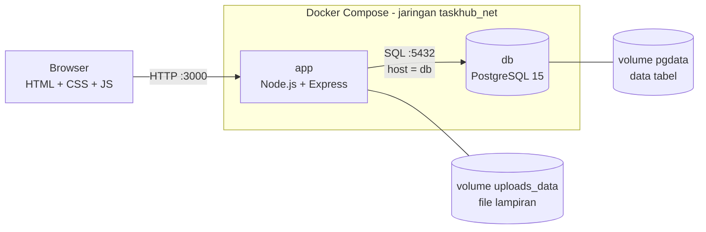

# TaskHub

Aplikasi manajemen proyek dan tugas multi-user untuk checkpoint **Cloud Services (COMP6991031)**. Tiap pengguna punya proyek, tugas, dan lampiran sendiri, dan datanya dipisahkan oleh PostgreSQL Row Level Security (RLS).

## Fitur

| Fitur | Keterangan |
|---|---|
| Akun | Daftar, masuk, keluar. Password di-hash (bcrypt), sesi memakai JWT di cookie httpOnly. |
| Dashboard | Total tugas, selesai, terlambat, tenggat hari ini, progres keseluruhan, rincian per prioritas, kategori, dan proyek, serta tenggat terdekat. Semua dihitung dengan SQL di backend. |
| Proyek | Beberapa proyek per pengguna, masing-masing punya daftar tugas dan progres sendiri (mis. "Cloud Services: 5/8 selesai"). |
| Tugas | CRUD dengan prioritas (Low/Medium/High), tenggat, kategori, dan status To Do / In Progress / Done. |
| Papan Kanban | Tiga kolom; kartu diseret (atau pakai tombol panah) untuk memindahkan status lewat API. |
| Lampiran | Banyak foto, file (PDF, docx/xlsx/pptx, zip, txt/csv/md), dan link per tugas. Maks 5 lampiran dan 5 MB per file (bisa diatur). |
| Pengingat | Tombol "Pengingat" di header dan panel di Dashboard: terlambat, tenggat hari ini, segera berakhir (<= 3 hari), dan tugas baru (24 jam terakhir). |
| Cari dan filter | Cari judul/catatan; filter status, proyek, kategori, prioritas, tenggat; pengurutan. |
| Log aktivitas | Pembuatan, perubahan, pindah status, hapus, dan lampiran tercatat di tabel `activity_log` dan di log container. |
| Operasional | Healthcheck (`/health`), indikator status database di UI, log request, validasi input tiga lapis. |

## Arsitektur



| Layanan | Image | Port | Volume | Healthcheck |
|---|---|---|---|---|
| `app` | `taskhub-app:3.0` (build dari Dockerfile) | `3000:3000` | `uploads_data` -> `/usr/src/app/uploads` | `GET /health` |
| `db` | `postgres:15-alpine` | `127.0.0.1:5432:5432` | `pgdata` -> `/var/lib/postgresql/data` | `pg_isready` |

`app` menghubungi database lewat nama service `db` (bukan `localhost`) dan baru start setelah `db` sehat (`depends_on: service_healthy`).

## Cara menjalankan

Prasyarat: Docker Desktop (atau Docker Engine + Compose v2).

```bash
cp .env.example .env         # lalu isi password dan JWT_SECRET
docker compose up -d --build
docker compose ps            # kedua container harus "healthy"
docker compose logs -f app   # lihat log
```

Buka http://localhost:3000. Tombol **alice** atau **bob** masuk dengan akun contoh (password `demo12345`, sesuai `DEMO_PASSWORD`).

- Berhenti: `docker compose down` (data tetap ada). Hapus semua data: `docker compose down -v`.
- Memperbarui dari versi sebelumnya: cukup `docker compose up -d --build`. Skema database dimigrasi otomatis (kolom `completed` -> `status`, `image_path` -> tabel `attachments`) tanpa menghapus data.
- Masih ada container lama (`todo_web_app`, `todo_postgres_db`)? Jalankan `docker compose down` di folder lama dulu agar port tidak bentrok.

## Skema database dan pembatasan akses

```
users(id, username UNIQUE, password_hash)
projects(id, user_id, name, color)                         UNIQUE(user_id, name)
categories(id, user_id, name, color)                       UNIQUE(user_id, name)
todos(id, user_id, project_id, category_id, title, description,
      priority, due_date, status, created_at, updated_at)
attachments(id, user_id, todo_id, kind 'file'|'link', name, url,
            stored_name, mime_type, size_bytes)
activity_log(id, user_id, todo_id, action, detail, created_at)
```

- **Constraint**: judul tidak kosong, prioritas `low/medium/high`, status `todo/in_progress/done`, warna `#RRGGBB`, file/link wajib punya `stored_name`/`url`.
- **Foreign key gabungan** `(project_id, user_id)`, `(category_id, user_id)`, dan `(todo_id, user_id)`: tugas tidak bisa memakai proyek/kategori milik pengguna lain, dan lampiran tidak bisa menempel pada tugas pengguna lain, bahkan bila kode aplikasi keliru.
- **RLS**: semua tabel milik pengguna memakai policy `user_id = app.current_user_id`. Setiap request menjalankan `SET LOCAL ROLE app_rls` lalu mengisi `app.current_user_id` dari JWT (`withUser()` di `db.js`). Role `app_rls` tidak punya akses ke tabel `users`, dan di `activity_log` hanya boleh `SELECT` dan `INSERT`.
- **Lampiran** tidak disajikan sebagai file publik. `/api/attachments/:id` mengecek kepemilikan lewat RLS; non-gambar selalu diunduh, tidak dirender browser.
- **Keamanan upload**: jenis file dikenali dari isinya (magic bytes), bukan ekstensi; nama file di disk acak (UUID); link hanya `http/https`.

Bukti RLS langsung di database:

```bash
docker exec -it taskhub_db psql -U postgres -d taskhub_db
```
```sql
BEGIN;
SET LOCAL ROLE app_rls;
SELECT set_config('app.current_user_id', '1', true);  -- alice
SELECT id, title FROM todos;                          -- hanya tugas alice
SELECT set_config('app.current_user_id', '2', true);  -- bob
SELECT id, title FROM todos;                          -- hanya tugas bob
ROLLBACK;
```

## API ringkas

| Method dan path | Fungsi |
|---|---|
| `GET /health` | Status layanan dan database |
| `POST /api/auth/register`, `/login`, `/logout`; `GET /api/auth/me` | Akun |
| `GET/POST /api/projects`, `PUT/DELETE /api/projects/:id` | Proyek (GET menyertakan progres) |
| `GET/POST /api/categories`, `PUT/DELETE /api/categories/:id` | Kategori |
| `GET /api/todos?status=&project=&category=&priority=&due=&q=&sort=` | Daftar tugas dengan filter |
| `POST /api/todos` (multipart: `files`, `link_url`) | Tambah tugas + lampiran |
| `PUT /api/todos/:id`, `PATCH /api/todos/:id/status`, `DELETE /api/todos/:id` | Ubah, pindah status, hapus |
| `POST /api/todos/:id/files`, `POST /api/todos/:id/links` | Tambah lampiran |
| `GET/DELETE /api/attachments/:id` | Unduh/hapus lampiran |
| `GET /api/dashboard`, `/api/todos/stats`, `/api/notifications`, `/api/activity` | Statistik, pengingat, riwayat |

## Pengujian

```bash
bash scripts/smoke-test.sh
```

Skrip menguji health, login, isolasi dua pengguna (tugas, proyek, lampiran, log), pemindahan status, upload file/link yang valid dan berbahaya, serta validasi input. Simpan tangkapan layar hasilnya sebagai bukti pengujian.

### Skenario demo untuk presentasi

**1. Alur aplikasi.** Masuk sebagai alice: lihat Dashboard (progres dan pengingat), buat proyek, tambah tugas dengan foto, PDF, dan link, buka tab Papan lalu seret kartu, cek tab Aktivitas. Keluar, masuk sebagai bob, dan tunjukkan datanya berbeda.

**2. Bukti image, container, port, jaringan, volume.**

```bash
docker images | grep -E "taskhub|postgres"
docker compose ps
docker network ls | grep taskhub
docker volume ls | grep taskhub
```

**3. Data tetap ada setelah container dibuat ulang (tanpa `-v`).**

```bash
docker compose down
docker compose up -d
```
Masuk lagi: tugas dan lampiran masih ada.

**4. Input salah.** Upload file `.txt` yang dinamai `.png`, atau isi link `javascript:alert(1)`. Server membalas `400` dengan pesan jelas; log menampilkan `-> 400`.

**5. Gangguan layanan dan pemulihan.**

```bash
docker compose stop db
curl -i http://localhost:3000/health     # 503, database DISCONNECTED
docker compose logs --tail 20 app        # diagnosis: "Health check gagal ... ECONNREFUSED"
docker compose start db
curl -i http://localhost:3000/health     # kembali 200 tanpa restart app
```
Indikator di sidebar berubah merah lalu hijau lagi.

## Hubungan dengan materi Week 1-7

| Week | Materi | Penerapan di proyek |
|---|---|---|
| 1 | Konsep cloud | Arsitektur 3 lapis; rencana deploy ke layanan cloud (lihat bawah) |
| 2 | Git dan Linux | Repo Git, `.gitignore`, `.dockerignore`, skrip bash `smoke-test.sh`, Alpine Linux |
| 3 | Jaringan dan HTTP | REST API, status code (200/201/400/401/404/409/413/503), cookie, port mapping, jaringan Docker |
| 4 | Virtualisasi dan container | Container `app` dan `db`, isolasi proses, user non-root |
| 5 | Dockerfile | Layer cache, `HEALTHCHECK`, `USER node`, `.dockerignore` |
| 6 | Docker Compose | Dua service, `depends_on` + healthcheck, network, named volume, `.env` |
| 7 | Database dan kontrol akses | PostgreSQL, constraint, foreign key gabungan, RLS, role `app_rls`, hash password |

## Rencana layanan cloud

- Container `app` ke **Cloud Run / ECS Fargate / Azure Container Apps** (image dari container registry)
- Database ke **managed PostgreSQL** (Cloud SQL / RDS / Azure Database for PostgreSQL), menggantikan container `db`
- Lampiran ke **object storage** (S3 / GCS / Azure Blob) menggantikan volume `uploads_data`
- Secret (`JWT_SECRET`, password DB) di **secret manager**, bukan di file `.env`
- HTTPS lewat load balancer, lalu set `COOKIE_SECURE=true`

## Struktur proyek

```
.
├── Dockerfile, docker-compose.yml, .env.example, .dockerignore, .gitignore
├── package.json
├── server.js          # routes, validasi, upload, error handler (berkomentar lengkap)
├── db.js              # pool, RLS (withUser), skema, data contoh
├── logger.js
├── db/init.sql        # skema + migrasi + RLS
├── public/            # index.html, style.css, app.js
└── scripts/smoke-test.sh
```

## Catatan kontribusi anggota

| Anggota | NIM | Kontribusi |
|---|---|---|
| (isi) | (isi) | (mis. backend/API dan validasi) |
| (isi) | (isi) | (mis. Docker, Compose, healthcheck, pengujian) |
| (isi) | (isi) | (mis. database/RLS, frontend, dokumentasi) |

## Pengembangan lanjutan

Penugasan tugas antar pengguna (saat ini pengingat "baru" berarti tugas yang baru ditambahkan sendiri), batas percobaan login (rate limit), reset password, dan pindah penyimpanan lampiran ke object storage.
